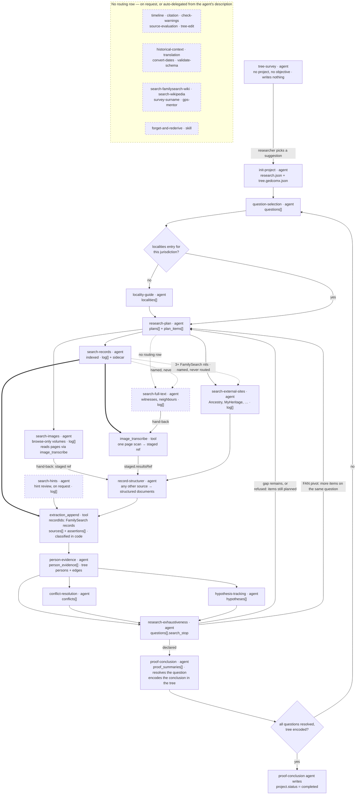

# Skills and agents — the data flow

What runs when, what each unit owns, and what it touches. If you want the research
*method*, read [`gps-research-flow.md`](gps-research-flow.md) first — this file is the
mechanics underneath it.

**Two files are authoritative and this one is not.** The order and the gates come from
the routing table in `packages/engine/plugin/skills/research/SKILL.md` — the table whose
header row reads `| If research.json has... | Invoke |`. Who may write each section of
persisted state comes from [`specs/schemas/ownership.json`](specs/schemas/ownership.json).
This file maps the two onto each other so you can see a whole run at once; where it
disagrees with either, they win.

There are 2 skills and 30 agents. Besides the `research` orchestrator itself, its routing
table names 14 of them, and 2 more are spawned from elsewhere in its body (`gps-mentor`,
`search-hints`). The other 15 have no routing row: one skill,
`forget-and-rederive`, and 14 agents reached on request or by auto-delegation from their
own `description` — see [Reachable only by asking](#reachable-only-by-asking).

---

## Three shapes

**Skill.** Runs in the caller's context, reads state, does the work, writes its own
section. Two remain: the `research` orchestrator and `forget-and-rederive`. A skill can
spawn an agent, because it runs on the main thread: `research` spawns most of the agents below.

**Agent.** Spawned as `@plugin:<name>` into fresh context, with its own `tools:` list and
`model:`. Every other unit is one. Only an agent carries an `agent_id`, which is what lets
the `PreToolUse` hook route a section's writes to exactly one caller.

**Agents do not spawn agents.** No agent grants `Agent` or `Task`, and
`tests/packaging/agent-tool-names.test.ts` fails any that does unless it is on the
empty `SPAWN_ALLOWED` list. When an agent's work needs another agent — a page scan read,
a record structured — it names that agent in its return and the main thread spawns it.
The hosted loader would honour a depth-2 spawn (`make probe-agent-nesting`); Cowork and
depth 3 are unmeasured. See `docs/architecture.md`, "Agents do not spawn agents".

**Thin router + agent.** A skill that resolves the request to one id, delegates and
relays. None remain: `person-evidence`, `proof-conclusion`, `search-images` and
`research-exhaustiveness` each lost its skill half, and the orchestrator spawns the agent
directly. Extraction runs in code through `extraction_append`, with the
`record-structurer` agent for a source that is not a FamilySearch record.

---

## The flow

Solid arrow: the orchestrator routes here on `research.json` state, spawning the target
when it is an agent; a solid arrow labelled "hand-back" is the orchestrator acting on what
the previous agent named in its return. Thick arrow: a skill calls or spawns the target
from its own context. Dotted: a prose mention with no routing row behind it. Dashed
boxes have no routing row; whether an autonomous run reaches them is unmeasured — see
[Reachable only by asking](#reachable-only-by-asking).

A *bounded* request — one record, one plan, a transcription, a status question — skips
the loop: the orchestrator hands it straight to the step that owns the deliverable and
ends the turn with `research_delivered` (research/SKILL.md, "Bounded request or job").

---

## The loop, in call order

| # | Skill / agent | Gate — true before it runs | Owns | Reads | Writes |
|---|---|---|---|---|---|
| 0 | **`tree-survey`** (agent) | No `research.json` and the message states no objective. Spawned as `@plugin:tree-survey`, with no `projectPath`. The orchestrator relays its suggestions and stops for the researcher's pick | The holes `tree_gaps` computed, ranked by what FamilySearch has for them (`pendingHints`, `coverage`); 3-5 suggestions, one question each | `tree_gaps` | Nothing — writes no project state by design |
| 1 | **`init-project`** (agent) | No `research.json` and the message states an objective, or the researcher picked a `tree-survey` suggestion. A guard clause refuses — reading no project file at all — if one exists | Creating both project files and the researcher profile | `person_read`; the user's words, as the delegation carries them | `research.json` `project` + empty sections and `tree.gedcomx.json` `persons`/`relationships`/`sources` — `project_create`; then `researcher_profile` and a `sources` entry per transcribed memory — `research_append`. Reports the import only; reviews nothing |
| 2 | **`research`** (skill, orchestrator) | Entry point. `research.json` exists | Routing — plus the contracts that forbid it doing the work inline (extraction, identity links, conflict/hypothesis, exhaustiveness/proof), the tree-encoding gate, and the bounded-request stop | `project_context` first, then `research_query` slices; it bans a whole-file `Read` of `research.json` for itself. `person_read` and `source_attachments` for what a linked person already has, before any search | The `extraction_append({ recordIds })` batch for pending FamilySearch records. Nothing else — every other write is delegated, and its own `project.status` write is refused by the hook |
| 3 | **`question-selection`** (agent) | Spawned as `@plugin:question-selection`. Objective but no questions; or every question is resolved and a fact the objective asks for has no question. Not for a FAN pivot: that is more plan items on the question already open | Minting at most one `q_` per invocation with its selection basis, and the step 1b stop signal ("no further questions — objective answered"). Not a question's `status` after creation | `project_context`, `research_query`; tree `persons` by `Read` of `tree.gedcomx.json` | `questions[]` append — `research_append`. Never `project` |
| 4 | **`locality-guide`** (agent) | A question has no plan **and** its target jurisdiction has no `localities` entry. One jurisdiction and period per spawn | The survey of what records survive for one place and period, persisted as the one `loc_` entry `research-plan` plans from | `place_search`, `place_search_all`, `place_population`, `collections_search`, `volume_search`, `catalog_search`, `external_links_search`, `wiki_search`, `wiki_read`, `wiki_place_page`, `wikipedia_search` | `localities` — one entry per jurisdiction, `research_append`; the place's curated external collections in `external-collections.json`, written by `external_links_search`. Nothing in standalone Q&A with no project |
| 5 | **`research-plan`** (agent) | Spawned as `@plugin:research-plan`. A question has no plan and its jurisdiction **already has** a `localities` entry; or exhaustiveness returned gaps to fill; or exhaustiveness refused a declaration over named `planned` items (Dispose mode) | Plan and plan-item structure — the sequenced record sets, their repositories, reasons and fallbacks. Never surveys a locality, never runs a search | `research.json` questions / plans / localities / log / assertions / proof_summaries through `project_context` and `research_query` (plus a whole-file `Read` of `research.json` for its narration line), and tree persons by `Read`; `person_read` for a tree person with an `ark`; `collections_search`, `volume_search`, `place_search`, `place_search_all`, `wiki_read`; the stored curated collections by `project_context` / `research_query` (`external_links_search` only for a place never fetched) | `plans` and `plan_items` in one batched `research_append`, a third-party item carrying `collection_url`; `plans[].status` → `superseded` or `completed`; in Dispose mode, the named items → `completed` or `skipped` (with a `skip_category`) |
| 6a | **`search-records`** (agent) | The question's **active** plan has items not yet executed and no analyzed evidence plausibly answers it; the item targets a FamilySearch indexed collection | Executing one already-chosen indexed search, triaging ranked candidates, logging every search including nil results. Hands back to `search-external-sites` after 3+ FamilySearch nils on an important item | `record_search`, `rank_search_matches`, `record_read`, `same_person`, `source_attachments`, `catalog_search`, `wiki_search`, `wiki_read`, `research_query` | `log[]` + its `results/<log_id>.json` sidecar — `research_log_append`; `plans[].items[].status` → `in_progress` — `research_append`, never `completed`; a `namesakes` row for each same-named person its search rules out — `research_append`, in its own call; extraction of its promising hits — `extraction_append({ recordIds })` when the delegation says to extract, and a hand-back to `record-structurer` for an image with no indexed record |
| 6b | **`search-external-sites`** (agent) | Same row, but the plan item targets a non-FamilySearch repository. Spawned as `@plugin:search-external-sites`, once per hand-off, triage or report, by the orchestrator when the plan item targets one of these sites. `search-records` names it in its hand-back after FamilySearch exhaustion, but no routing row spawns it from that return, so that hand-off is not routed automatically | Constructing the pre-filled URL and the hand-off, and triaging the capture the user brings back. Never loads an external page | `project_context` (`awaitingUser`, `externalCollections`), `research_query` (`external_collections`); the plan item's `collection_url`; `place_search`, `collections_search`, `build_external_search_url`, and `external_links_search` only for a place never fetched; the capture, by path or text in the delegation | The in-flight `log[]` entry — written by `build_external_search_url` when given `projectPath`; the closing and nil entries — `research_log_append`; `plans[].items[].status`, `completed` once a capture is triaged — `research_append`. Names records for `record-structurer` in its return |
| 6c | **`search-images`** (agent) | A plan item targets a browse-only FamilySearch record set, or indexed and full-text search are exhausted — unless `project_context`'s `exhaustedImageGroups` lists the item, which goes to `research-plan` to dispose of instead. The routing row names it without the `@plugin:` prefix — see [Stated twice](#stated-twice-differently) | Browsing a volume page by page — the OCR happens host-side and the page is staged, so neither the scan nor its text enters its context until it reads a page. Finds one year in a split group with `volume_bisect`, and a cited item with `image_search`'s `item` route | `volume_search`, `image_search`, `volume_bisect`, `image_transcribe`, `sidecar_read`; `research.json` by whole-file `Read` | `log[]` — `research_log_append`, **no sidecar**; `plans[].items[].status` — `research_append`. Hands each found image's `staged.resultsRef` to `record-structurer` in its return |
| 6d | **`search-full-text`** (agent) | **No routing row names it.** Reached by auto-delegation from its `description`, or a direct request. Its own step 1 picks the next `planned` full-text item | Lucene-style search over FamilySearch's AI-transcribed images — the only lane that reaches a person named anywhere in an unindexed document: as witness, bondsman, appraiser or neighbour, and as the principal of a paragraph-style record no name index covers | `fulltext_search`, `get_name_variants`, `source_attachments`, `wiki_search`, `wiki_read`; `research.json` by whole-file `Read` | `log[]` + sidecar — `research_log_append`; `plans[].items[].status` — `research_append`. Names each promising hit's `results/<log_id>.json#<hit id>` ref for `record-structurer` in its return, with `image_transcribe` only for a transcript too garbled to extract |
| 6e | **`search-hints`** (agent) | Spawned as `@plugin:search-hints`, twice (triage, then the researcher's verdicts; the orchestrator stops between). On a user's request to review a person's FamilySearch hints, **and** on an unexecuted `record_type: "fs_hints"` plan item — research-plan emits one at `sequence` 1 on an identity or parentage question whose person has an `ark` (issue #3153), and the unexecuted-item routing row sends it here with its `planItemId`/`planId`/`personId`; the verdicts turn passes them again while that item is `in_progress` | Triage of each pending hint — `accept`, `reject` or `not enough information to judge`, FamilySearch's confidence disclosed, the image read before any reject; and the log of each verdict the researcher stated | `person_record_matches` (`status: ["pending"]`), `research_query`, `record_read`, `image_transcribe`, `sidecar_read`, `person_read`; `tree.gedcomx.json` by `Read` | `plans[].items[].status` of its hints item — `research_append` (completed, or skipped/`inaccessible` when hints can't be read, the person has no FamilySearch id, or no researcher is present); `log[]` — `research_log_append`, one entry per decided hint (and one `negative` entry on no hints), no sidecar. Triage writes only the item's status, and nothing when no item was handed over. Accepted hints' positive entries then route to extraction |
| 7 | **`extraction_append`** (tool) | **Any** `log[]` entry with a positive or partial outcome and no assertion referencing it — even one, even late in a run. The orchestrator forbids extracting inline; it, or `search-records`, calls the tool with `recordIds` for FamilySearch records | Every assertion in each record, with its roles and three-layer GPS classification decided in code (`src/utils/record-extract.ts`) — **first and final**; no downstream refinement pass exists. Also takes `absences` for negative evidence | Each record, read live by `record_read` host-side, or an earlier uncited read's sidecar | One `record_read` `log[]` entry per record read live; `sources` + `assertions`, and the mirroring tree `S` source description; a re-found record's assertions gain the caller's question ids. `plans[].items[].status` `in_progress` → `completed` once a record a plan item's `record_search` found, or a hit its `fulltext_search` found, is extracted, in code. `person_evidence` only in `personId` mode, and only unchecked attachment links (`speculative`, no score, the fixed rationale); identity decisions stay person-evidence's |
| 7 | **`record-structurer`** (agent) | Spawned once per batch of sources that are not FamilySearch indexed records — an image transcription, a full-text hit, PDF text, pasted or external-site text | Reading each source and sending one structured document per source in one `extraction_append({ documents })`; roles and classifications are decided in code (`src/utils/structured-document.ts`) | `sidecar_read`, the delegated text. Never reads `research.json` or the tree | `sources` + `assertions`, through `extraction_append` only |
| 8 | **`person-evidence`** (agent) | Spawned as `@plugin:person-evidence` with the assertion ids. Assertions not yet linked to persons. Always the agent — writing a `pe_` link inline is how a same-named stranger's record gets attached to the subject | The identity decision — which tree person each persona is — scored with `same_person` first; and the household skeleton the link requires | `project_context`, `research_query`; `record_read`; `merge_warnings`, `person_warnings`, `person_quality`; `place_search`, `place_distance`, `wiki_read`; `tree.gedcomx.json` walked directly | `person_evidence` — `research_append`; tree `persons` and their sourced facts — `materialize_facts`; tree `relationships` (a household record's ParentChild and Couple edges only) — `tree_edit`. While a namesake of the person is recorded in `namesakes`, `research_append` caps a link it writes at `speculative` unless something in its record ties it to that person (search-records records each same-named person its searches rule out, and hands the links its row leaves untied to person-evidence) |
| 9 | **`conflict-resolution`** (agent) | Spawned as `@plugin:conflict-resolution` with the conflict or competing assertion ids. Evidence conflicts present. Inline elimination of a namesake, or comparing two records for shared identity, is forbidden anywhere else | `conflicts` — independence analysis, the weighing, and the resolution rationale or the documented deferral | `research_query` and whole-file `Read`; `place_search`, `place_search_all`, `place_distance`, `convert_calendar`, `wiki_read` | `conflicts[]` only — `research_append`. A resolve must name its `resolution_kind` (`competitor`, `tree` or `synthesis`), and the tool refuses one that does not |
| 10 | **`hypothesis-tracking`** (agent) | Spawned as `@plugin:hypothesis-tracking`. Identity uncertainty across assertions, or `project_context` reports `competingParentSets` for the question — one hypothesis per parent couple | `hypotheses` — the `active` → `supported` / `ruled_out` transitions and the reasoning behind each | `research.json` by whole-file `Read`; `validate_research_schema` | `hypotheses[]` only — `research_append` |
| 11 | **`research-exhaustiveness`** (agent) | Spawned as `@plugin:research-exhaustiveness` with `questionId` + `projectPath` when analyzed evidence plausibly answers the question — **even with plan items still `planned`** — or all items are `completed`/`skipped`. The declaration is refused while an item on the question's **active** plan is `in_progress` or `planned`; a refusal naming leftover items routes to `research-plan`'s Dispose mode | The seven stop criteria, assessed in order as a gate and stopping at the first that fails. The **only** caller permitted to set a non-null `search_stop.stopped_because` | `project_context`, `research_query`, `Read`, `wiki_read` | `questions[].search_stop`, and on the declare path `questions[].status = "exhaustive_declared"` — one `research_append` update |
| 12 | **`proof-conclusion`** (agent) | Spawned as `@plugin:proof-conclusion` with `questionId` + `projectPath` when a question is at `exhaustive_declared` with no `proof_summaries` entry, or re-invoked because a tier-≥-probable conclusion is not yet in the tree. Its own three-check gate — unresolved conflicts, unclassified assertions, unlinked persons — hard-blocks before Step 1 | Tier and form selection, the self-contained narrative, and the tree encoding | `project_context`, `research_query`, `Read`, `source_attachments`, `merge_warnings` | `proof_summaries[]` + the question's `status`/`resolved`/`resolution_assertion_ids` in one batch, and `project` — `research_append`; tree `relationships`, `persons[].facts[]` and `sources` at tier ≥ probable — `tree_edit` / `tree_correct` (a fact cited onto a person with a recorded namesake needs that record tied to them); a proved identity — `merge_tree_persons` |
| 13 | **`proof-conclusion`** (agent), re-entered | Every question `resolved`, every fact the objective asks for covered by one, **and** each tier-≥-probable conclusion encoded in the tree. The orchestrator routes here and does not write | Closing the project | `research_query` | `project.status = "completed"` — `research_append`, refused by the tool while a blocking conflict is unresolved |
| — | **`gps-mentor`** (agent) | **No routing row.** Only when the user asks — "second opinion", "review my work", "is this defensible?" — with `focus: "on-demand"`, including on a completed project. `proof-conclusion`'s closing sentence tells the user they can ask. An `address_first` verdict never blocks | One structured advisory verdict. It holds no search tool — it grades what was gathered | `project_context`, `research_query`, the `evaluations/` verdict files via `sidecar_read`, `validate_research_schema`, `collections_search`, the place and wiki tools | `evaluations[]` — `research_append`, plus `superseded_by` on the prior entry for the same focus and target. The verdict file under `evaluations/` is written by the tool |

---

## How the project gets closed

Three components meet at the last step, and the split is easy to get wrong because each
one holds a piece of the answer.

| Component | Holds | Does not hold |
|---|---|---|
| **`question-selection`** | Whether the **objective** is answered. Its step 1b is the autonomous stop point: every *independent* part of the objective `resolved` with a `proof_summary` at `probable` or better, with corroboration explicitly not required | Any write to `project`. It signals and returns |
| **`research`** (orchestrator) | The routing decision — which component runs next, the tree-encoding gate, and re-invoking `proof-conclusion` once the stop point is reached | The write. Its routing table says "You never write it yourself", and the hook refuses it |
| **`proof-conclusion`** (agent) | The `project.status = "completed"` write, and the tree-encoding check before it — every tier-≥-probable conclusion encoded in the tree (the tool warns rather than refuses when one is not) | Any view of `project.objective`. It never reads that field |

All four planes agree: the routing table, the `project` row of the ownership manifest,
`research_append`'s own comment, and the `PreToolUse` hook, whose `OWNED_FIELDS` routes
`project.status` to the proof-conclusion agent. The rule is field-scoped, not
section-scoped — `project` stays out of `OWNED_SECTIONS` because the section is
co-written, and every other write to it, including the `updated` activity ping, is
untouched.

**The condition the agent fires on is not the condition that should close a project.**
`agents/proof-conclusion.md` step 8 writes `completed` when "ALL questions are now
`resolved`". Since PR #1819 that agent also resolves the question it concluded, in the
same batch as the summary — so its own condition is true the moment it finishes the
**first** question of an objective that will need a second one, before
`question-selection` has minted the next. The agent cannot tell the two cases apart: it
holds no view of the objective, and "all questions resolved" is a proxy that is briefly
true on the way to every multi-question objective. The tool refuses the write only while
a blocking conflict is unresolved, so the premature write can land on that first pass.

What closes the gap is the re-invocation seam, not a wider condition: `question-selection`
returns its stop-point signal, the orchestrator re-invokes `proof-conclusion`, and that
call makes the write. Do not instead widen step 8's condition — the agent has nothing to
evaluate it against. PR #3518 is making the seam a handshake (issue #3240).

---

## Outside the loop

Nothing in the routing table names these. They fire when the user asks, on auto-delegation
from their own `description`, or on a hand-back from a sibling.

| Unit | Triggered by | Owns | Reads | Writes |
|---|---|---|---|---|
| **`timeline`** (agent) | "build a timeline"; hand-backs from `person-evidence`, `conflict-resolution`, `hypothesis-tracking` | `timelines` — regenerated wholesale, never edited entry by entry — with gaps and geographic feasibility | `project_context`, `research_query` (paged until `truncated` is false), `Read`; `place_search`, `place_search_all`, `place_distance`, `wiki_read` | `timelines[]` — `research_append` |
| **`citation`** (agent) | "fix this citation", "format to Evidence Explained" | Refining `citation` and the six `citation_detail` fields on a source that already exists. **Never creates one**. Fetches the creating office for a probate record from `{State}_Probate_Records` | Whole-file `Read` of `research.json` and the tree; `wiki_read`, `validate_research_schema` | `sources[].citation`, `.citation_detail`, `.notes` — `research_append` `op: "update"` only |
| **`check-warnings`** (agent) | "Check for problems"; a mother's 1900/1910 census children-born and children-living counts. **Not** on import or after every tree write — the writers refuse a write that introduces an unjustified warning | Running the offline impossibility check for a single person's own data, and reporting which of a mother's children the tree is missing. Hands a source conflict, a source audit or a schema check back to its owner. Never fixes anything | `person_warnings`, `census_children_gap`; no file reads | `log`: one `check_warnings` entry with the full reply in `notes` — `research_log_append`. Nothing with no project |
| **`source-evaluation`** (agent) | "evaluate / audit / review the sources on this profile" | Auditing the sources **already attached** to a person: an index error (re-read and correct), a misattributed source (detach), or un-actionable FamilySearch backend metadata. A source-vs-source disagreement is characterised with no winner picked; resolving one is `conflict-resolution`'s. Never fixes anything, never extracts | `person_read`, `record_read`, `source_attachments`, `person_quality`, `person_warnings` over the project's tree only when it holds the audited person; `Read` | `log`: one `source_evaluation` entry with the full report in `notes` — `research_log_append`. Nothing with no project |
| **`tree-edit`** (agent) | Direct user correction; a merge after a conclusion established identity at probable or better; listing a person's attached records or matches | Out-of-pipeline tree changes and person merges | `tree.gedcomx.json` by `Read`; `place_search`, `place_search_all`, `person_record_matches`, `person_person_matches` | Tree `persons`, `relationships`, `facts`, `names`, `sources` — `tree_edit` / `tree_correct`. A merge via `merge_tree_persons` also repoints ids in `research.json` — the manifest authorizes that by tool identity — and is refused when a relationship joins the pair, when it would fold a FamilySearch or starting-tree person into one made during the run, or when it would move a link, or carry a record's data, under a recorded namesake with nothing in that record tying it to the person; `tree_edit` and `tree_correct` refuse a fact or name citing a record onto a person with a recorded namesake when that record does not tie to them |
| **`translation`** (agent) | A non-English record or term; hand-back from `historical-context` | Transcription, translation as an explicitly derivative rendering, and paleography | The text or an image path in the delegation; `Read`. **No MCP tool** | `log`: one `translation` entry with the full reply in `notes` — `research_log_append`. Nothing with no project |
| **`historical-context`** (agent) | "why does this record look like this", boundary and naming questions | Narrative context — what the sources say, kept distinct from what it merely believes | `wiki_search`, `wiki_read`, `wikipedia_search`, `place_search`, `place_search_all`, `place_population`; `Read` | `log`: one entry per wiki/Wikipedia lookup and one `historical_context` entry with the full overview in `notes` — `research_log_append`. Nothing with no project |
| **`convert-dates`** (agent) | Julian/Gregorian, Old Style, Quaker months, double dating, French Republican dates | Identifying the calendar regime; the arithmetic belongs to the tool | `convert_calendar`; `Read` | `log`: one `convert_dates` entry with the full reply in `notes` — `research_log_append`. Nothing with no project — and **nothing downstream persists the converted date** into a fact |
| **`search-familysearch-wiki`** (agent) | Any "how do I find [record type]" question | Wiki guidance, synthesized only from returned chunks | `wiki_search` | `log`: one entry, the summary in `notes` — `research_log_append`. Nothing with no project |
| **`search-wikipedia`** (agent) | A single-article encyclopedia lookup | The verbatim article extract — no paraphrase | `wikipedia_search` | `log`: one entry, the summary in `notes` — `research_log_append`. Nothing with no project |
| **`validate-schema`** (agent) | "validate", "check the files" | Relaying validator errors in plain terms with a non-regressing fix each | `validate_research_schema` | `log`: one `validate_schema` entry with the full reply in `notes` — `research_log_append`. Nothing with no project. Never edits a file to fix an error |
| **`survey-surname`** (agent) | "find every Dixon family in Virginia censuses", tabulate a surname across censuses | Per-year `record_search` sweep, grouped by `recordArk`, sectioned by year and collection, with non-population schedules separate | `place_search`, `record_search` (with `projectPath`) | `log[]` — `research_log_append`: one entry per search page, plus one `survey_surname` entry with the household table in `notes` |
| **`forget-and-rederive`** (skill) | Practice mode — the researcher asks for a known answer to be stripped | Removing a tree slice with cascade so it must be re-derived from records, and holding the rederivation to account | `project_context`; a `dryRun` read-back. **Forbidden** from reading `tree.gedcomx.json` | Tree slice removed and `.tree-before-forget.gedcomx.json` written — `tree_forget`. Touches no `research.json` |

---

## Who may write what

The inverse view. `owner` is the single skill or agent that owns the section's structure;
the other writers are permitted narrower edits. Full contract, including the failure each
rule prevents, is in [`specs/schemas/ownership.json`](specs/schemas/ownership.json).
Wherever `merge_tree_persons` appears it is authorized by tool identity: a merge repoints
the absorbed person's id in every section that holds person ids.

| Artifact | Section | Owner | Other permitted writers | Writer tool | Enforced by |
|---|---|---|---|---|---|
| `research.json` | `project` | `init-project` | `proof-conclusion` (status + `updated`) | `project_create`, `research_append`, `merge_tree_persons` | unit + hook — the hook routes `project.status` to the proof-conclusion agent (field-scoped; the rest of the section is co-written and untouched). A diff confined to `updated` is exempt at both, so the activity ping is free to any writer |
| | `researcher_profile` | `init-project` | any caller, to correct a field | `research_append` | **nothing** |
| | `questions` | `question-selection` | `research-exhaustiveness`, `proof-conclusion` | `research_append` | unit + hook + tool — the hook routes any non-null `search_stop.stopped_because` to `research-exhaustiveness`; the tool refuses a `resolved` with no proof summary, a declaration while the active plan has `in_progress` or `planned` items, and a new question while another's search is in flight |
| | `plans` / `plan_items` | `research-plan` | `search-records`, `search-external-sites`, `search-full-text`, `search-images`, `search-hints`, for `items[].status` only; `extraction_append`, by tool identity, for `items[].status` `in_progress` → `completed` only | `research_append`, `extraction_append` | unit on `plans` (whole-section only — it cannot tell a status flip from a rewritten plan); **nothing** on `plan_items`. The hook keeps the five search agents to `plan_items` |
| | `log` | none by design — append-only, multi-writer | `search-records`, `search-external-sites`, `search-full-text`, `search-images`, `search-hints`, `survey-surname`, `search-wikipedia`, `search-familysearch-wiki`, `historical-context`, `source-evaluation`, `check-warnings`, `translation`, `convert-dates`, `validate-schema`; `extraction_append` for its own `record_read` entries | `research_log_append`, `build_external_search_url`, `extraction_append` | unit + tool |
| | `sources` | none — written in code by `extraction_append`, whoever calls it | `citation` (refine only, never create); `init-project` (one entry per transcribed memory, at creation) | `research_append`, `extraction_append` | unit; create-vs-refine held by tool identity |
| | `assertions` | none — written in code by `extraction_append`, whoever calls it | — | `extraction_append`; `research_append` only for an update setting `informant_bias_notes` alone | unit + tool |
| | `person_evidence` | `person-evidence` | `extraction_append`, by tool identity, for unchecked attachment links only | `research_append`, `merge_tree_persons`, `extraction_append` | unit + hook — the hook denies the section to every caller but the person-evidence **agent**; `extraction_append`'s attachment links, written only in `personId` mode, never pass the hook |
| | `rejected_links` | `person-evidence` | — | `research_append`, `merge_tree_persons` | unit + hook + tool — the hook denies the section to every caller but the person-evidence **agent**; `research_append` refuses a `person_evidence` write that creates, moves onto or revives a rejected pair |
| | `namesakes` | `search-records` | `merge_tree_persons`, by tool identity, re-keys a row onto the merge survivor; `research_append` stamps `record_persona_ids` itself | `research_append`, `merge_tree_persons` | unit + hook + tool — the hook denies the section to every caller but the search-records **agent**; `research_append` refuses an update that re-points a row or sets `record_persona_ids` |
| | `conflicts` | `conflict-resolution` | — | `research_append` | unit + hook + tool. The hook is CLAIM-scoped: it denies a resolve, or any of the analysis fields (`independence_analysis`, `weighing_analysis`, `preferred_assertion_id`, `resolution_rationale`, `resolution_kind`, `resolved_value`, `weighed_log_entry_ids`), to every caller but the conflict-resolution **agent**, while a skeleton open or a re-open passes. The tool refuses a resolve that does not name its `resolution_kind`, and owns `weighed_log_entry_ids`' value: it fills it on the unresolved analysis that sends it, refuses it on a write with no `independence_analysis`, and clears it on any other analysis or a settle |
| | `hypotheses` | `hypothesis-tracking` | — | `research_append` | unit + tool |
| | `timelines` | `timeline` | `timeline_build`, by tool identity, for a person's own timeline only | `research_append`, `merge_tree_persons`, `timeline_build` | unit |
| | `proof_summaries` | `proof-conclusion` | — | `research_append`, `merge_tree_persons` | unit + hook — the hook denies the section unless the caller is the proof-conclusion **agent** |
| | `evaluations` | `gps-mentor` | — | `research_append` | hook — the section is routed to the gps-mentor **agent** (issue #3191), so the main-thread write is denied too; the per-agent lanes already kept every other agent off it |
| | `localities` | `locality-guide` | — | `research_append` | unit |
| | `warning_justifications` | none — appended by the warning gate as a side effect of a justified tree write | — | `tree_edit`, `tree_correct`, `merge_tree_persons`, `materialize_facts` | **nothing** |
| `tree.gedcomx.json` | `persons` | none by design — co-equal writers | `init-project`, `person-evidence`, `tree-edit`, `proof-conclusion`, `forget-and-rederive` | `project_create`, `tree_edit`, `tree_correct`, `materialize_facts`, `merge_tree_persons`, `tree_forget`, plus `research_append`/`extraction_append` for the assertion-backlink fact rewrite only (authorized by tool identity, not by adding a caller — `tree-materialization-spec.md` §4.4) | unit |
| | `relationships` | none by design — same writers | same writers | same, less `materialize_facts` and the two append tools | unit |
| | `sources` | none — `extraction_append` mints each source description in code | `init-project`, `tree-edit`, `proof-conclusion`, `person-evidence`, `citation` | `project_create`, `research_append`, `extraction_append`, `tree_edit`, `tree_correct` | unit |

Three consequences worth holding onto:

- **A skill's `allowed-tools` does not restrict anything.** It is a grant, and both
  production paths hold every tool the server advertises. The three surfaces that
  actually bind are the writer tool's own preconditions, an agent's `tools:`,
  and the `PreToolUse` hook.
- **Only one skill holds `research_query`** — `research` — and eleven
  of the thirty agents, `search-records` among them. Everything else that needs project state does a whole-file
  `Read`, which is the thing the orchestrator forbids for itself because `research.json`
  reaches 100+ assertions by late run.
- **The hook is the only plane that discriminates by caller**, in
  `packages/engine/plugin/hooks/guard_project_files.py`. On `research_append` it carries
  six maps: `OWNED_SECTIONS` gives `proof_summaries` to proof-conclusion and
  `person_evidence` and `rejected_links` to person-evidence; `OWNED_DECLARATIONS` gives a non-null
  `search_stop.stopped_because` to research-exhaustiveness; `OWNED_FIELDS` gives
  `project.status` to proof-conclusion; `OWNED_CLAIMS` gives a conflict's resolve and
  analysis fields to conflict-resolution; `OWNED_APPENDS` gives creating a question to
  question-selection; and `AGENT_WRITABLE_SECTIONS` holds every agent
  that has `research_append` to its own sections, which is what keeps the exhaustiveness
  agent off `plan_items` so it cannot clear its own blocker. Separately it refuses a raw
  `Write`/`Edit`/`device_commit_files` to a protected project file. Every other row above
  is prose plus a unit check that runs only inside a paid per-skill eval run.

---

## Stated twice, differently

Each of these is two files disagreeing about the same flow. They are listed so you do not
pick one at random and build on it.

1. **Who moves a FamilySearch plan item out of `in_progress`.** `search-records` sets
   `in_progress` and refuses `completed`: "that is set once extraction has created the
   assertions". That is now true in code: `extraction_append` completes an `in_progress`
   item once a record one of its positive or partial `record_search` searches found is
   extracted. One gap remains. An item whose searches all found nothing is never
   completed by extraction, so it stays `in_progress` until `research-exhaustiveness`
   refuses its declaration, and the routing row that follows a refusal sends only
   `planned` items to `research-plan`'s Dispose mode.
   `research-plan` says the executing skills make the transition. `search-external-sites`
   and `search-images` set `completed` themselves.
2. **How `search-images` is invoked.** Its routing row reads `search-images` with no
   `@plugin:` prefix, and the table says an entry without the prefix is a `Skill` call —
   but the skill was deleted and only the agent exists. The same row describes the browse
   as `volume_search` → `image_search` → `image_read`; the agent holds `image_transcribe`,
   not `image_read`.

---

## Reachable only by asking

No routing-table row names these, so an autonomous `/research` run reaches them only if
the main thread delegates on its own judgment:

- **`forget-and-rederive`**, the one skill. It is operator-driven by design.
- **14 agents**: `check-warnings`, `citation`, `convert-dates`, `historical-context`,
  `search-familysearch-wiki`, `search-full-text`, `search-wikipedia`, `source-evaluation`,
  `survey-surname`, `timeline`, `translation`, `tree-edit`, `validate-schema`, `where-else-to-search`. An agent is
  auto-delegated from its own `description`, so a missing row does not mean it cannot
  fire. **Whether each actually fires is unmeasured** — issue #3220 tracks that nothing
  measures agent triggering.

For most of them that is the intent — they are utilities the researcher asks for. Three
are not obviously intentional:

- **`search-full-text`** is the only lane that reaches a person named anywhere in a
  machine-transcribed document — as a witness, bondsman, appraiser, executor or
  neighbour, and as the principal of a paragraph-style record that was never
  name-indexed. The orchestrator has rows for indexed search, external sites and image
  browsing, and none for this one; `search-records` names full-text as the next step and
  will not delegate to it.
- **`citation`** has no row, so in an autonomous run citations stay at the working
  quality `extraction_append` writes unless the main thread delegates to it.
- **`timeline`** has no row either, so `timelines` stays empty unless the main thread
  delegates to it on a hand-back.

Nothing compares the routing table's Invoke column against the skills and agents that
exist, so a row can name a unit that no longer exists and every suite stays green — the
`search-images` row above is that case.
